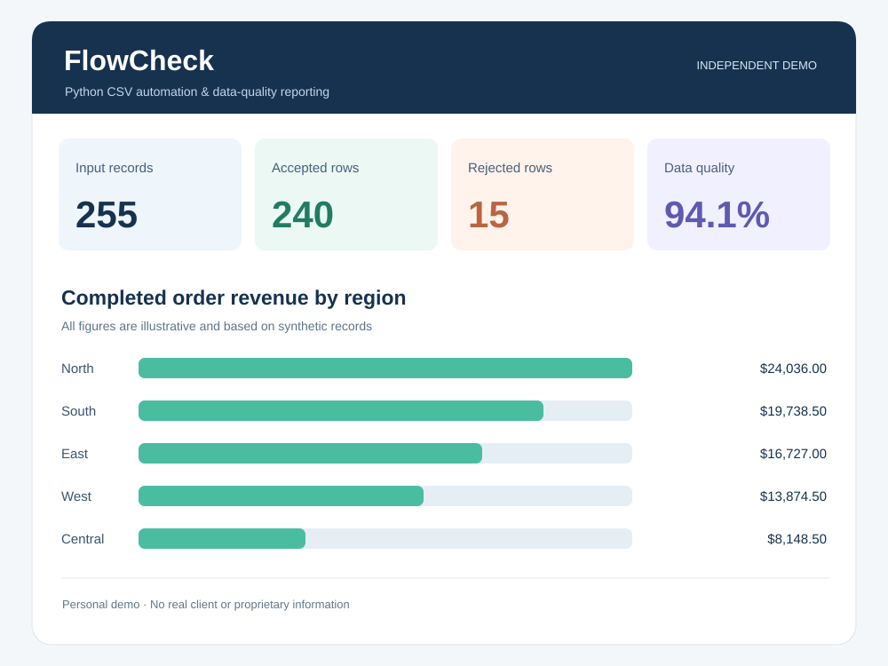

# FlowCheck — Python CSV Data Quality & Reporting

**Independent portfolio demonstration — synthetic data only. Not commissioned by a client.**

FlowCheck is a small Python automation tool that validates operational CSV data and generates ready-to-review deliverables. It shows how repetitive spreadsheet-like checks can become a repeatable, auditable workflow.



## Problem it solves

Operations teams often receive CSV exports that contain duplicate records, missing values, inconsistent dates, or invalid amounts. Manual checking is slow and easy to get wrong. FlowCheck separates valid records from exceptions and produces an HTML summary without needing a database or web server.

## What it does

- Reads CSV order data and validates mandatory columns and values.
- Detects duplicate order IDs, invalid dates, non-positive quantities, negative prices, and unknown statuses/regions.
- Saves cleaned records and rejected rows with explicit reasons.
- Calculates completed-order revenue with `Decimal` to avoid floating-point rounding artifacts.
- Creates a self-contained HTML dashboard and a machine-readable JSON summary.
- Includes synthetic input data and automated tests.

## Quick start

Requires **Python 3.10+**. No external packages.

```bash
python app.py --input data/sample_orders.csv --out demo_output
python -m unittest discover -s tests -v
```

Open `demo_output/report.html` in a browser. Output files:

| File | Description |
|---|---|
| `clean_orders.csv` | Validated rows, normalized fields and calculated line totals |
| `rejected_rows.csv` | Row number, order ID, rejection reason |
| `summary.json` | Counts, quality metric, revenue and grouped metrics |
| `report.html` | Offline HTML dashboard suitable for sharing or printing |

## Sample data

The bundled CSV is generated reproducibly using `python data/make_sample.py` and contains intentionally invalid records. All customers, orders and metrics are fictional. The demo does not connect to private systems.

## Scope and limitations

This is a self-contained CSV demonstration, **not** a production financial system or a live API integration. It does not claim to have saved a real client money or hours. Real-world deployments would also require organization-specific business rules, data access controls, scheduled runs, and operational monitoring as appropriate.

## Portfolio usage

Screenshot PNGs for Upwork are provided in the original downloadable portfolio ZIP; you can also generate them locally with `python docs/capture.py` after installing optional dependencies. This repository includes `docs/portfolio_preview.svg`. Use the Upwork project title **Python CSV Automation & Reporting Demo** and label it *Independent demo project (synthetic data)*.

## Screenshots

The original screenshots were captured from the generated `report.html` and are supplied separately in the portfolio ZIP. For new screenshots, install Playwright and Pillow plus a Chromium browser, then run `python docs/capture.py`. Image capture is optional and is not required to use the app.

## Portfolio description

See [`UPWORK_PORTFOLIO.md`](UPWORK_PORTFOLIO.md) for suggested copy, skill tags and media order.